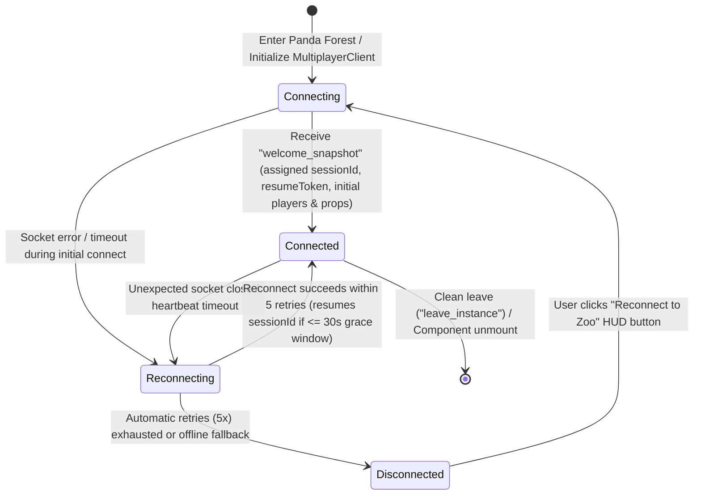

# Data Model: Multiplayer Foundation (Feature 002)

**Feature Branch**: `002-multiplayer-foundation`  
**Date**: 2026-11-04  
**Related Spec**: [spec.md](./spec.md) | **Research**: [research.md](./research.md)

## 1. Core Domain Entities (`@online-zoo/game-core`)

### 1.1 `MultiplayerConnectionStatus` & `MultiplayerSessionUIState`

Represents the client-visible multiplayer connectivity and room metadata stored in `gameStore` for HUD rendering (`FR-014`–`FR-017`).

```ts
export type MultiplayerConnectionStatus =
  | 'connecting'
  | 'connected'
  | 'reconnecting'
  | 'disconnected';

export interface RemoteVisitorSummary {
  sessionId: string;
  displayName: string;
  accentColor: string;
  locomotionState: LocomotionState;
}

export interface MultiplayerSessionUIState {
  status: MultiplayerConnectionStatus;
  roomId: string;
  localSessionId: string | null;
  localDisplayName: string | null;
  localAccentColor: string | null;
  visitorCount: number;
  reconnectAttempt: number;
  maxReconnectAttempts: number;
  lastDisconnectReason: string | null;
  remoteVisitors: Record<string, RemoteVisitorSummary>;
}
```

### 1.2 `PlayerSessionIdentity` & `AuthoritativePlayerTransform`

Represents a connected player's transient identity and validated spatial state inside a `ZooInstanceRoom` (`FR-002`, `FR-007`, `FR-011`–`FR-013`).

```ts
export interface AuthoritativePlayerTransform {
  position: [number, number, number];
  velocity: [number, number, number];
  facingYaw: number;
  locomotionState: LocomotionState;
  sequence: number;
  serverTimestamp: number;
  reconciled?: boolean;
  discrepancyDistance?: number;
}

export interface PlayerSessionRecord {
  sessionId: string;
  resumeToken: string;
  displayName: string;
  accentColor: string;
  roomId: string;
  spawnIndex: number;
  connectedAt: number;
  lastHeartbeatAt: number;
  lastMoveAt: number;
  transform: AuthoritativePlayerTransform;
}

export interface ResumableSessionEntry {
  record: PlayerSessionRecord;
  disconnectedAt: number;
  expiresAt: number; // disconnectedAt + 30_000 (30-second grace window)
}
```

### 1.3 `ZooInstanceRoom` (Volatile Server-Side Room State)

Represents a bounded Panda Forest multiplayer instance hosting up to `16` concurrent visitors in volatile memory (`FR-001`, `FR-004`, `FR-010`, `FR-013`).

```ts
export interface SharedPropAuthorityState {
  objectId: string;
  active: boolean;
  lastTriggeredBy: string | null;
  lastTriggeredAt: number;
}

export interface ZooInstanceRoom {
  roomId: string;
  maxPlayers: number; // Default: 16
  nextVisitorNumber: number; // Starts at 101 ("Explorer #101")
  activeSessions: Map<string, PlayerSessionRecord>;
  resumableSessions: Map<string, ResumableSessionEntry>; // Keyed by resumeToken
  propStates: Record<string, SharedPropAuthorityState>;
  tickSequence: number;
  lastTickAt: number;
}
```

### 1.4 `RemotePlayerInterpolationState` (High-Frequency Client Runtime Buffer)

Maintained in `mutableRuntimeState.remotePlayers` (`Map<string, RemotePlayerInterpolationState>`) so `@online-zoo/game-client` interpolates all remote avatars at 60–120 Hz without triggering React component re-renders (`FR-008`, `FR-009`, `SC-003`).

```ts
export interface RemoteTransformSnapshot {
  position: [number, number, number];
  velocity: [number, number, number];
  facingYaw: number;
  locomotionState: LocomotionState;
  sequence: number;
  serverTimestamp: number;
  receivedAt: number;
}

export interface RemotePlayerInterpolationState {
  sessionId: string;
  displayName: string;
  accentColor: string;
  /** Ring buffer of recent authoritative snapshots (up to 10 entries, ordered by sequence) */
  snapshots: RemoteTransformSnapshot[];
  /** Current 60Hz interpolated render state read directly by RemotePlayerAvatar useFrame */
  renderPosition: [number, number, number];
  renderYaw: number;
  renderLocomotionState: LocomotionState;
  lastUpdatedAt: number;
}
```

### 1.5 `LocalReconciliationState` (Client Prediction & Smooth Reconciliation)

Maintained in `mutableRuntimeState.reconciliation` to smoothly correct minor server-client drift (`< 2.0m` over `~150ms`) or immediately snap large discrepancies (`>= 2.0m`) (`Clarification #3`, `FR-012`).

```ts
export interface LocalReconciliationState {
  pendingOffset: [number, number, number];
  lastAcknowledgedSequence: number;
  lastServerPosition: [number, number, number];
  reconciliationCount: number;
  lastSnapAt: number;
}
```

---

## 2. Validation Rules & Invariants

| Rule ID | Target Entity / Field | Validation Logic | Requirement |
| :--- | :--- | :--- | :--- |
| **VR-001** | `ZooInstanceRoom.activeSessions` | `activeSessions.size <= maxPlayers` (`16`). If `default` room is full, overflow joins route to `panda-forest-2`, etc. | `FR-001`, Edge Case 5 |
| **VR-002** | `PlayerSessionRecord.accentColor` | Deterministically chosen from an 8-color accessible park palette (`['#10b981', '#f59e0b', '#3b82f6', '#ec4899', '#8b5cf6', '#14b8a6', '#f97316', '#06b6d4']`) via `hash(sessionId) % 8`. | `FR-002`, `FR-009`, Clarification #4 |
| **VR-003** | Spawn Plaza Assignment | Initial spawn coordinate computed on a golden-angle spiral within `radius <= 2.2m` around `[0, 0.1, 18]` and passed through `resolveHorizontalWorldCollisions` so simultaneous arrivals do not stack on `[0, 0.1, 18]`. | `FR-003`, Edge Case 1 |
| **VR-004** | Sequence Monotonicity | Incoming `player_move` packets with `sequence <= session.transform.sequence` or non-finite numbers (`NaN`, `Infinity`) are rejected immediately. | `FR-012`, Edge Case 3 |
| **VR-005** | Maximum Legal Velocity Clamp | Horizontal displacement `Δxz` over `dt = clamp((now - lastMoveAt)/1000, 0.016, 1.0)` is bounded to `maxDist = 7.5 * 1.25 * dt + 0.35`. Excess displacement is clamped along the movement vector and marks `reconciled = true`. | `FR-011`, `FR-012`, `SC-006` |
| **VR-006** | World & Pond Collision Authority | Candidate `[x, y, z]` is clamped to `y ∈ [0.1, 4.5]` and passed through `resolveHorizontalWorldCollisions(pos, 0.45, PANDA_FOREST_LAYOUT)` enforcing the `36m` perimeter fence, `6.7m` pond shoreline barrier at `[-8, 0, -4]`, and all 22 solid obstacles. | `FR-011`, `SC-006` |
| **VR-007** | Client Discrepancy Reconciliation | When `reconciled === true` or drift exceeds `0.15m`: if horizontal discrepancy `d < 2.0m`, blend local avatar position over `~150ms`; if `d >= 2.0m`, snap immediately to authoritative coordinates. | `FR-012`, Clarification #3 |
| **VR-008** | Heartbeat & Grace Window | Inactive sessions (`now - lastHeartbeatAt > 8_000ms`) or closed sockets are removed from `activeSessions` (`<= 10s` cleanup) and stored in `resumableSessions` for `30_000ms` (`30s` grace window). | `FR-005`, `FR-016`, `SC-004`, Clarification #1 |
| **VR-009** | Zero Persistent Storage | All `ZooInstanceRoom` state lives exclusively in volatile Node/runtime memory (`Map`); zero movement or session state is written to disk or databases. | `FR-013`, `SC-009` |

---

## 3. State Lifecycle Transitions



